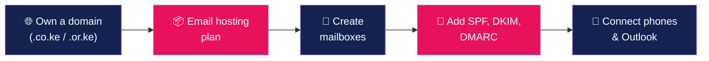

# 📧 Business Email Setup — Kenya

### Get `you@yourbusiness.co.ke` working on phone, Outlook and webmail — and keep it out of spam

[Why it matters](#-why-not-just-use-gmail) •
[Settings](#%EF%B8%8F-universal-mail-settings) •
[Phone & Outlook](docs/device-setup.md) •
[Deliverability](docs/spf-dkim-dmarc.md) •
[Troubleshooting](#-troubleshooting)

---

## 🤔 Why not just use Gmail?

| | `@gmail.com` | `@yourbusiness.co.ke` |
|---|:---:|:---:|
| Looks professional to clients & tenders | ❌ | ✅ |
| You own the address if a staff member leaves | ❌ | ✅ |
| Accepted as an *official* channel by regulators | ⚠️ | ✅ |
| One address per department (`accounts@`, `hr@`) | ❌ | ✅ |
| Brand reinforcement on every message | ❌ | ✅ |

> [!TIP]
> **Hospitals, schools, SACCOs, churches and NGOs** — an official domain email is increasingly expected for regulators and funders. Institution packages exist with unlimited mailboxes: see [HostingKE Institutions](https://hostingke.co.ke/institutions).

---

## 🗺️ The 5-step setup

1. **Domain** — don't have one? [Search .ke domains](https://hostingke.co.ke/domains/search).
2. **Email hosting** — e.g. [Business Email](https://hostingke.co.ke/services/business-email) or a [hosting plan with email](https://hostingke.co.ke/products/email-hosting).
3. **Mailboxes** — in cPanel: *Email → Email Accounts → + Create*. Use strong, unique passwords.
4. **Authentication records** — follow [SPF, DKIM & DMARC](docs/spf-dkim-dmarc.md). This is what keeps you **out of spam**.
5. **Devices** — follow [Phone & Outlook setup](docs/device-setup.md).

---

## ⚙️ Universal mail settings

Replace `yourbusiness.co.ke` with your domain. On cPanel hosting these settings are almost always:

| Setting | Incoming (IMAP) ✅ recommended | Incoming (POP3) | Outgoing (SMTP) |
|---|---|---|---|
| **Server** | `mail.yourbusiness.co.ke` | `mail.yourbusiness.co.ke` | `mail.yourbusiness.co.ke` |
| **Port** | `993` | `995` | `465` (SSL) or `587` (STARTTLS) |
| **Security** | SSL/TLS | SSL/TLS | SSL/TLS or STARTTLS |
| **Username** | full address `you@yourbusiness.co.ke` | full address | full address |
| **Auth** | Password | Password | ✅ Required |

> [!NOTE]
> Use **IMAP**, not POP3, if you read mail on more than one device. IMAP keeps everything in sync; POP3 downloads and often deletes from the server.

🌍 **Webmail:** `https://yourbusiness.co.ke/webmail` (or `https://mail.yourbusiness.co.ke:2096` on cPanel).

---

## 👥 Recommended mailbox structure

| Mailbox | Use | Tip |
|---|---|---|
| `info@` | Public contact on website & cards | Forward to 2 people so nothing is missed |
| `accounts@` | Invoices, KRA, M-Pesa statements | Restrict access |
| `hr@` / `careers@` | Recruitment | Auto-reply acknowledging CVs |
| `support@` | Customer support | Connect to a ticket system |
| `firstname@` | Each staff member | Disable (don't delete) when staff leave |

---

## 🧯 Troubleshooting

<b>📤 I can receive but can't send</b>

- SMTP authentication must be **on** ("My outgoing server requires authentication").
- Try port `587` + STARTTLS if `465` is blocked by your network.
- Check the mailbox isn't over quota.

<b>🗑️ My emails land in the client's spam</b>

- Add/repair **SPF, DKIM and DMARC** — see [the guide](docs/spf-dkim-dmarc.md).
- Avoid ALL-CAPS subjects, link-only messages and large attachments.
- Test at [mail-tester.com](https://www.mail-tester.com) — aim for 9/10+.

<b>🔑 "Password incorrect" on phone but works in webmail</b>

Username must be the **full email address**. Remove and re-add the account if the phone cached an old password.

<b>📭 Not receiving any email</b>

Check MX records: `dig +short yourbusiness.co.ke MX`. They must point to your email provider only. See [DNS basics](https://github.com/edgecomcoke/kenya-domain-guide/blob/main/docs/dns-basics.md).

---

## 📚 More guides in this series

| Guide | |
|---|---|
| 🇰🇪 [Kenya Domain Guide](https://github.com/edgecomcoke/kenya-domain-guide) | Choosing between `.co.ke`, `.or.ke`, `.ac.ke`, `.sc.ke`, `.ke` |
| 🖥️ [Kenya Web Hosting Guide](https://github.com/edgecomcoke/kenya-web-hosting-guide) | Hosting types and app deployment |
| 🚀 [Website Launch Checklist Kenya](https://github.com/edgecomcoke/website-launch-checklist-kenya) | Pre-launch checks |

---

### 📬 Want it done for you?

Maintained by **[HostingKE](https://hostingke.co.ke)** · 📞 +254 182 917 312 · 💬 [WhatsApp](https://wa.me/254182917312)

Content licensed under CC BY 4.0. Corrections welcome via issues and pull requests.

