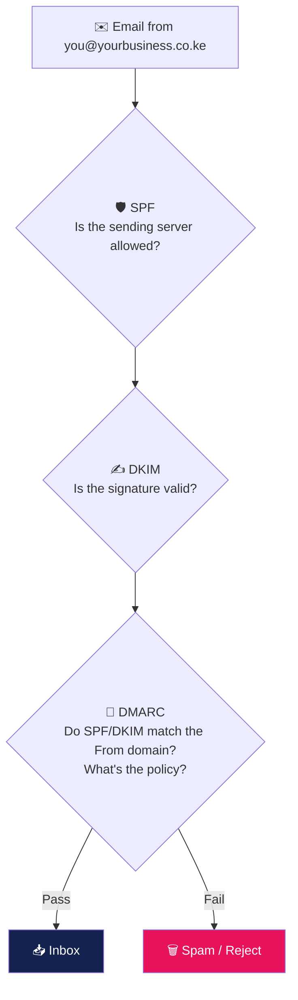

# 🔐 SPF, DKIM & DMARC — Keep Your Email Out of Spam

[← Back to Business Email Setup](../README.md)

Since 2024 Gmail, Yahoo and Microsoft reject or spam-folder mail from domains without proper authentication. These three DNS records prove your mail is really from you.



---

## 🛡️ 1. SPF — who may send for your domain

One `TXT` record on `@`:

| Your setup | SPF value |
|---|---|
| cPanel hosting only | `v=spf1 +a +mx ~all` |
| Google Workspace | `v=spf1 include:_spf.google.com ~all` |
| Microsoft 365 | `v=spf1 include:spf.protection.outlook.com ~all` |
| cPanel **+** a bulk mail service | `v=spf1 +a +mx include:<service-spf-domain> ~all` |

> [!WARNING]
> Only **one** SPF record per domain. Two SPF records = SPF fails. Merge `include:` entries into a single line.

## ✍️ 2. DKIM — a digital signature on every message

- **cPanel:** *Email → Email Deliverability → Manage* → install the suggested DKIM record (often automatic if DNS is on the same server).
- **Google Workspace:** *Admin → Apps → Gmail → Authenticate email* → generate key → add `google._domainkey` TXT record → click *Start authentication*.
- **Microsoft 365:** enable DKIM in Defender and add the two `selector1/selector2` CNAMEs.

## 📜 3. DMARC — the policy

Add a `TXT` record on `_dmarc`:

```text
Start (monitor only):
v=DMARC1; p=none; rua=mailto:dmarc@yourbusiness.co.ke

After 2–4 weeks with no problems:
v=DMARC1; p=quarantine; rua=mailto:dmarc@yourbusiness.co.ke

Full protection against spoofing:
v=DMARC1; p=reject; rua=mailto:dmarc@yourbusiness.co.ke
```

## 🧪 Verify

```bash
dig +short yourbusiness.co.ke TXT          # SPF
dig +short default._domainkey.yourbusiness.co.ke TXT   # DKIM (cPanel selector)
dig +short _dmarc.yourbusiness.co.ke TXT   # DMARC
```

Then send a test to [mail-tester.com](https://www.mail-tester.com) and open the message's **"Show original"** in Gmail — you want `SPF: PASS`, `DKIM: PASS`, `DMARC: PASS`.

## ✅ Deliverability checklist

- [ ] One SPF record, ending in `~all` or `-all`
- [ ] DKIM shows **valid** in cPanel / Admin console
- [ ] DMARC record exists (start with `p=none`)
- [ ] Reverse DNS (PTR) of the sending server matches its hostname *(ask your host)*
- [ ] Server IP not on blacklists — check [mxtoolbox.com/blacklists](https://mxtoolbox.com/blacklists.aspx)
- [ ] Bulk newsletters sent via a proper mailing service, not your mailbox

> 💡 HostingKE email plans come with SPF and DKIM configured. [See plans →](https://hostingke.co.ke/products/email-hosting)
